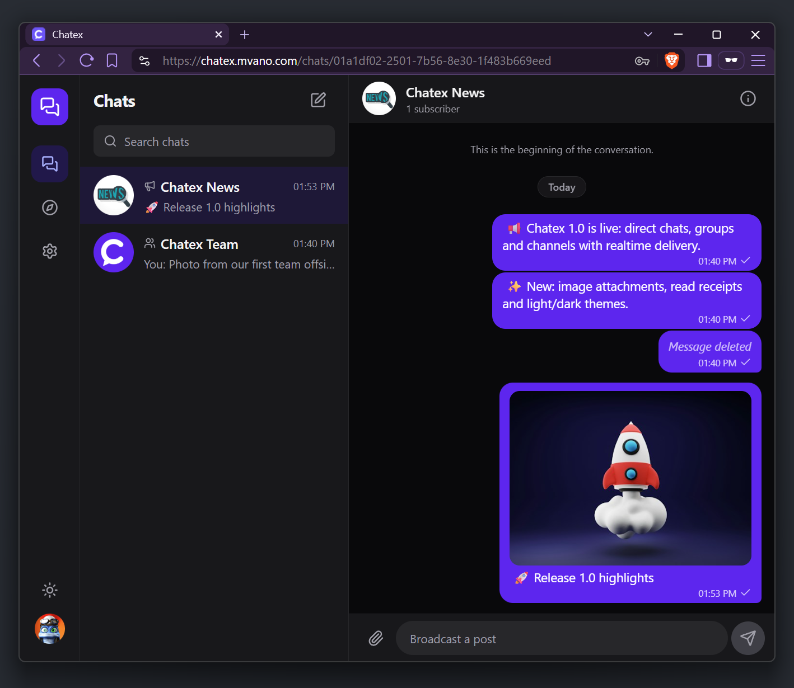

# Chatex

[](https://github.com/musicvano/Chatex/actions/workflows/ci.yml?query=branch%3Adev)
[](LICENSE.md)
[](https://dotnet.microsoft.com/)
[](https://angular.dev/)
[](https://www.postgresql.org/)

A web messenger with direct chats, groups and channels. The backend is ASP.NET Core with SignalR and PostgreSQL; the frontend is Angular with Tailwind CSS and works on phones, tablets and desktops.



## Features

- **Accounts**: registration, login by user name or email, account lockout after 5 failed attempts, JWT access tokens with rotating refresh tokens (reusing a refresh token ends every session of that user).
- **Profiles**: display name, bio, avatar, last seen, user search.
- **Chats**, Telegram style: direct chats (one per pair of users), groups (up to 1000 members) and channels (only the owner and admins post). Public groups and channels have a unique `@handle` and can be searched and joined; private ones are invisible to non-members. Roles: owner, admin, member, subscriber. See [Chat rules](Docs/ChatRules.md).
- **Messages**: send, reply, edit, delete, read receipts, unread counts, history with cursor (keyset) pagination.
- **Attachments**: uploads with a size limit and a content-type allow-list, downloads for chat members only.
- **Realtime** over SignalR: new, edited and deleted messages, read receipts, membership and chat changes, typing indicators, online presence with last seen.
- **Production**: rate-limited sign-in, a database health check that drives automatic rollback, hourly cleanup of unsent uploads and old refresh tokens, security headers and a Content-Security-Policy in Nginx.

## Tech stack

| Area       | Choice                                                                                                               |
| ---------- | -------------------------------------------------------------------------------------------------------------------- |
| Runtime    | .NET 10 (C# 14)                                                                                                      |
| Database   | PostgreSQL 18, EF Core 10 with Npgsql, snake_case naming                                                             |
| Api        | Minimal APIs, ProblemDetails (RFC 9457), OpenAPI with Scalar                                                         |
| Realtime   | ASP.NET Core SignalR, in-memory presence (one process, no backplane)                                                 |
| Auth       | ASP.NET Core Identity, JWT bearer (HMAC-SHA256), refresh token in an HttpOnly cookie                                 |
| Validation | FluentValidation                                                                                                     |
| Tests      | xUnit v3, Shouldly, Testcontainers (PostgreSQL), Respawn, WebApplicationFactory                                      |
| Frontend   | Angular 22 (standalone, signals, zoneless), Tailwind CSS v4, Angular CDK, `@microsoft/signalr`, Lucide icons, Vitest |
| CI/CD      | GitHub Actions; deploys to Nginx + systemd on Ubuntu ([Deployment](Docs/Deployment.md))                              |
| Planned    | Playwright end-to-end tests                                                                                          |

## Quick start

You need the .NET 10 SDK, Docker, Node.js 24 and PowerShell 7; see [Getting started](Docs/GettingStarted.md) for details and configuration.

```bash
./Run.ps1 setup
```

```bash
./Run.ps1 api
```

In a second terminal:

```bash
./Run.ps1 web
```

Open http://localhost:4200 for the app and http://localhost:5214/scalar for the API reference.

## Commands

`Run.ps1` wraps the everyday commands; run it without arguments to list them.

| Command                                | What it does                                                                         |
| -------------------------------------- | ------------------------------------------------------------------------------------ |
| `./Run.ps1 setup`                      | first run: restores tools and packages, starts PostgreSQL and applies the migrations |
| `./Run.ps1 api`, `./Run.ps1 web`       | runs the API (port 5214) or the Angular dev server (port 4200)                       |
| `./Run.ps1 test [dotnet test options]` | runs all tests, or only `dotnet test` with the given options                         |
| `./Run.ps1 check`                      | runs every CI check locally                                                          |
| `./Run.ps1 migration <Name>`           | adds an EF Core migration                                                            |

## Project structure

```
Source/
  Chatex.Api/     HTTP endpoints, SignalR hub, auth, rate limiting, background maintenance
  Chatex.Core/    business logic: services, permissions, validation, DTOs
  Chatex.Data/    EF Core entities, repositories, migrations, file storage
  Chatex.Web/     Angular app
Tests/            backend tests against a real PostgreSQL (Testcontainers)
Deploy/           systemd unit, Nginx site, settings template, activation script
Docs/             documentation
```

## Documentation

| Document                                  | What it covers                                                          |
| ----------------------------------------- | ----------------------------------------------------------------------- |
| [Getting started](Docs/GettingStarted.md) | prerequisites, configuration, database, running the API and the web app |
| [Architecture](Docs/Architecture.md)      | backend layers, the `Result` pattern, request flow, repository layout   |
| [Data model](Docs/DataModel.md)           | entities, ids, paging, soft deletes, file storage, migrations           |
| [Chat rules](Docs/ChatRules.md)           | chat types, roles, permissions, visibility                              |
| [HTTP API](Docs/HttpApi.md)               | routes, tokens, paging, limits, error codes                             |
| [Realtime](Docs/Realtime.md)              | SignalR hub events, presence, reconnects                                |
| [Frontend](Docs/Frontend.md)              | the Angular app                                                         |
| [Testing](Docs/Testing.md)                | backend and frontend tests                                              |
| [Deployment](Docs/Deployment.md)          | server setup, GitHub Actions deploy, rollback                           |

## License

Licensed under the [MIT License](LICENSE.md).
